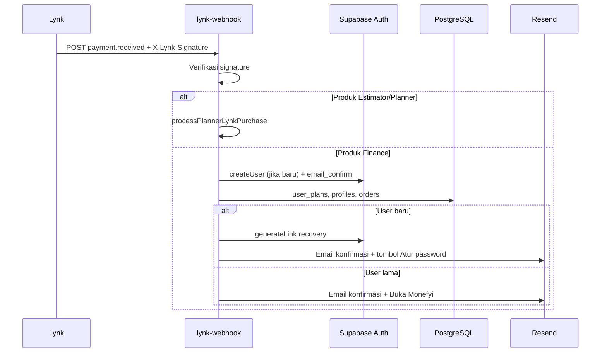

# Email transaksional Monefyi — panduan bersama

Dokumen ini menjelaskan **alur otomatis** (pembayaran Lynk, buat akun, atur/ganti password) dan **cara menambah email baru** di produk Monefyi (Finance PWA, Estimator, Planner).

**Infrastruktur:** [Resend](https://resend.com) + Supabase Auth (Send Email Hook) + Edge Functions di `my-supabase-project/supabase/functions/`.

---

## 1. Dua jalur email

| Jalur | Pemicu | Edge Function | Template |
|-------|--------|---------------|----------|
| **Auth** | Signup, lupa password, magic link, ubah email | `auth-send-email` (Supabase Auth Hook) | `monefyi-email-layout.ts` + copy di `auth-send-email/index.ts` |
| **Pembelian / produk** | Webhook Lynk `payment.received` | `lynk-webhook` (Finance) · `planner-lynk-webhook` / branch Estimator di `lynk-webhook` | `finance-purchase-email.ts` · `purchase-email.ts` |
| **Kolaborasi Planner** | Undangan, welcome, join request | `planner-*` + `_shared/email.ts` | `email-templates.ts` |

Semua HTML memakai **layout bersama** (`_shared/monefyi-email-layout.ts`): badge produk, kartu putih, tombol CTA, footer support.

---

## 2. Alur Finance (keuangan pribadi) — `app.monefyi.com`

### 2.1 Setelah bayar di Lynk (Monthly / Lifetime)



**Perilaku penting (Finance):**

- **Tidak ada password plain-text di email** (sejak layout baru). User baru mendapat link **Atur password & masuk** (`generateLink` type `recovery`).
- Akun dibuat dengan password acak internal; user **wajib** set password lewat link.
- User lama: paket diperpanjang / upgrade; **password tidak berubah**.

Env function `lynk-webhook`:

- `APP_URL=https://app.monefyi.com` (redirect set password & tombol buka app)
- `LYNK_MERCHANT_KEY`, `RESEND_*` — lihat [`../planner/LYNK_WEBHOOK.md`](../planner/LYNK_WEBHOOK.md)

Kode: `lynk-webhook/index.ts`, template `finance-purchase-email.ts`.

### 2.2 Lupa password / ganti password (Finance)

1. Di PWA: login → **Lupa password** → `auth.resetPasswordForEmail(email, { redirectTo: origin })`  
   (`app/js/app.js`)
2. Supabase Auth memicu hook **`auth-send-email`** → Resend kirim email **Reset password** dengan link verify.
3. User klik link → kembali ke `app.monefyi.com` → Supabase session recovery → user set password baru di UI auth.

Branding email auth mengikuti **`redirect_to`** URL (Estimator / Planner / Finance otomatis). Override opsional: secret `MONEFYI_EMAIL_PRODUCT=finance|planner|estimator` pada function `auth-send-email`.

---

## 3. Alur Estimator / Planner (pembayaran Lynk)

Sama dengan Finance untuk **user baru**: `processPlannerLynkPurchase` → `generateSetupPasswordUrl` → email `purchase-email.ts`.

Perbedaan:

- Aktivasi **`planner_org_subscriptions`** + org, bukan `user_plans`.
- Redirect atur password: `ESTIMATOR_APP_URL/...` atau Planner app URL.
- Webhook duplicate: Estimator **tetap bisa kirim ulang email**; Finance mengabaikan duplicate event (hanya `alreadyProcessed`).

Detail Lynk: [`../planner/LYNK_WEBHOOK.md`](../planner/LYNK_WEBHOOK.md) · Resend: [`../planner/LYNK_RESEND_SETUP.md`](../planner/LYNK_RESEND_SETUP.md).

---

## 4. Design system email

| Produk | `MONEFYI_EMAIL_PRODUCT` | Warna accent | Nama di header |
|--------|---------------------------|--------------|----------------|
| Finance PWA | `finance` | `#10b981` | Monefyi |
| Planner | `planner` | `#6366f1` | Monefyi Planner |
| Estimator | `estimator` | `#059669` | Monefyi Estimator |

**File inti:**

| File | Fungsi |
|------|--------|
| `_shared/monefyi-email-layout.ts` | `monefyiEmailShell`, tombol, kartu ringkasan, `formatIdr`, `resolveEmailBrand` |
| `_shared/auth-setup-link.ts` | Link sekali pakai atur password (Lynk / user baru) |
| `_shared/finance-purchase-email.ts` | Konfirmasi bayar Finance |
| `_shared/purchase-email.ts` | Konfirmasi bayar Estimator |
| `_shared/email-templates.ts` | Undangan, welcome, auth CTA Planner |
| `_shared/email.ts` | `sendEmail` / `sendEmailSafe` → Resend API |

**Prinsip desain:**

- Inline CSS + tabel (kompatibel klien email).
- Preheader tersembunyi untuk inbox preview.
- Satu CTA utama per email.
- Versi **text/plain** selalu dikirim bersama HTML.

---

## 5. Menambah email di produk baru

1. Tambah brand di `EMAIL_BRANDS` (`monefyi-email-layout.ts`) jika produk baru.
2. Buat `your-product-email.ts` yang memanggil `monefyiEmailShell({ brand, title, bodyHtml })`.
3. Kirim via `sendEmailSafe` dari Edge Function (jangan expose API key di frontend).
4. Set `RESEND_FROM_EMAIL` verified domain (`support.monefyi.com`).
5. Untuk auth: pastikan Auth Hook aktif; brand dari `redirect_to` atau `MONEFYI_EMAIL_PRODUCT`.
6. Dokumentasikan env di README produk + baris di tabel §1 dokumen ini.

Contoh minimal:

```typescript
import { EMAIL_BRANDS, emailParagraph, emailPrimaryButton, monefyiEmailShell } from "./monefyi-email-layout.ts";
import { sendEmailSafe } from "./email.ts";

const brand = EMAIL_BRANDS.finance;
const html = monefyiEmailShell({
  brand,
  title: "Judul",
  bodyHtml: emailParagraph("Isi.") + emailPrimaryButton("CTA", "https://...", brand.accent),
});
await sendEmailSafe({ to: user@example.com, subject: "...", html, text: "..." });
```

---

## 6. Deploy & env wajib

```bash
cd my-supabase-project
npx supabase functions deploy lynk-webhook planner-lynk-webhook auth-send-email --no-verify-jwt
```

| Secret | Function | Keterangan |
|--------|----------|------------|
| `RESEND_API_KEY` | semua pengirim | Wajib production |
| `RESEND_FROM_EMAIL` | semua | Verified sender |
| `SEND_EMAIL_HOOK_SECRET` | `auth-send-email` | Dari Supabase Auth → Hooks |
| `LYNK_MERCHANT_KEY` | webhook Lynk | Signature SHA256 |
| `APP_URL` | `lynk-webhook`, `auth-send-email` | Default redirect / fallback brand |
| `MONEFYI_EMAIL_PRODUCT` | opsional | Override brand auth |
| `ESTIMATOR_*` / `PLANNER_*` | Estimator branch | URL app |

Hook Auth: Dashboard → **Authentication** → **Hooks** → Send Email → `auth-send-email`.

---

## 7. QA checklist singkat

- [ ] Lynk test / bayar → email konfirmasi, layout badge produk benar.
- [ ] User baru: tombol **Atur password** valid (bukan password di body).
- [ ] User lama: teks “password tidak berubah”.
- [ ] Finance: **Lupa password** → subject “Reset password — Monefyi”, link buka app.
- [ ] Resend Dashboard → Logs → delivered.
- [ ] Spam folder / domain DKIM OK.

---

## 8. Keamanan

- Jangan kirim password plain-text atau merchant key di email.
- Link recovery / verify: sekali pakai, kedaluwarsa — jangan log URL penuh di production.
- Verifikasi webhook Lynk sebelum proses payload.

---

## Referensi kode (Finance)

- Pembayaran: `my-supabase-project/supabase/functions/lynk-webhook/index.ts`
- Lupa password UI: `app/js/app.js` (`resetPasswordForEmail`)
- Master arsitektur: [`../MONEFYI_MASTER.md`](../MONEFYI_MASTER.md)
