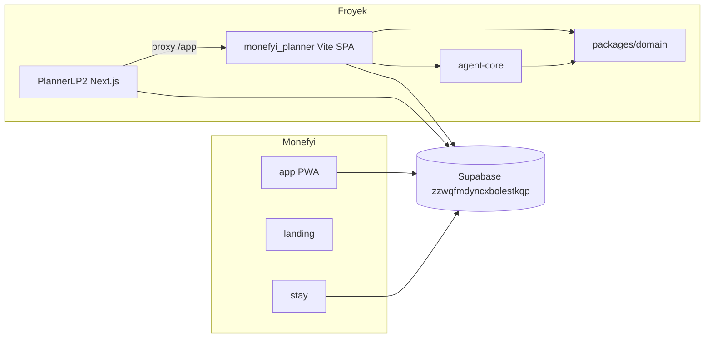

# 00 — Inventaris pemisahan Froyek

**Tahap:** 0 (pemetaan, tanpa ubah kode produk)
**Branch:** `chore/froyek-split` (dari `main`, belum di-push, belum di-merge)
**Tanggal:** 2026-11-23
**Remote:** `https://github.com/hanifrullyantp/monefyi.git`

Dokumen ini memetakan dua produk yang sekarang hidup di satu repo. Tidak ada file produk yang dipindah atau diubah pada tahap ini.

## Ringkasan tahap

| | |
|---|---|
| Yang diubah | 1 file baru: `docs/migration/00-inventory.md`. Branch baru `chore/froyek-split`. |
| Yang sengaja tidak diubah | Seluruh kode, config deploy, migrasi SQL, workflow, dan `main`. Produksi tetap di `main`. |
| Risiko tersisa | Belum ada pemisahan fisik. Database, auth, dan webhook masih satu project Supabase. Logo lockup yang disebut panduan merek tidak ada di repo. |
| Berhenti | Ya. Tahap 1 menunggu kata **lanjut**. |

## Repo dan cara membangun

- Satu git repo. Branch produksi `main` sejajar dengan `origin/main` saat branch ini dibuat.
- Package manager: **npm**, lockfile per aplikasi. Tidak ada pnpm workspace. Tidak ada Docker.
- Backend bersama: project Supabase `zzwqfmdyncxbolestkqp`, folder [my-supabase-project/supabase](../../my-supabase-project/supabase). `config.toml` memakai `project_id = "my-supabase-project"`. Migrasi di folder itu: 126 file. Ada pohon kedua di [supabase](../../supabase) (42 migrasi, fungsi `stay-xendit` saja) yang terpisah dari pohon utama.

## Klasifikasi folder

### Froyek

| Path | Stack / peran | Build dan uji |
|---|---|---|
| [monefyi_planner](../../monefyi_planner) | SPA produksi. React 19, Vite 7, Tailwind 4, Zustand, Vitest. Nama package `monefyi-planner`. Root Directory Vercel = folder ini. PDF di `src/lib/pdf/`. | `npm test`, `npm run build` |
| [PlannerLP2](../../PlannerLP2) | Next.js 16. Host `froyek.com` dan `estimator.froyek.com` lewat env `ESTIMATOR_STANDALONE`. Nama package `nextjs-postgresql-template`. | `npm run typecheck`, `npm run test:froyek`, `npm run test:all-engine`, `npm run build` |
| [packages/domain](../../packages/domain) | Uang, tanggal, validasi. Diimpor hanya oleh SPA dan `agent-core`. Bukan milik app keuangan. | Tidak punya `package.json` sendiri |
| [agent-core](../../agent-core) | SOP dan agen. Diimpor SPA. Salinan kanal juga ada di edge functions. | Tidak punya `package.json` sendiri |
| [evals](../../evals) | Skenario eval agen. | Dipakai gerbang eval |
| [remotion](../../remotion) | Video pemasaran Estimator (`EstimatorMotionVideo`, `Estimator3DVideo`, `EstimatorWebGL60s`, `CustomerHilangVideo`). | Dari root: `npm run video:dev`, `npm run video:render` |

Estimator **bukan** aplikasi terpisah. Ia mode dari SPA yang sama dan landing Next yang sama.

Workflow GitHub yang milik jalur Froyek:

- `.github/workflows/planner-spa-deploy.yml` — push `main` + path `monefyi_planner/**` → `npm ci` + `npm run build` + `vercel deploy --prod`
- `.github/workflows/planner-lp2-deploy.yml` — path `PlannerLP2/**` → typecheck, build, deploy
- `.github/workflows/estimator-lp-deploy.yml` — path `PlannerLP2/**`, `Mini App Monefyi/**`, `EstimatorLP/**`
- `.github/workflows/planner-landing-deploy.yml` — path `Planner-Landing-Page/**`
- `.github/workflows/supabase-planner-deploy.yml` — `workflow_dispatch` saja; `supabase db push` dari `my-supabase-project`
- `.github/workflows/agent-eval.yml` — pull request dan push

Dokumen produk (ikut Froyek saat repo dipisah, belum dipindah):

- `docs/planner/`, `docs/APA_ITU_PLANNER.md`, `docs/MONEFYI_PLANNER_MASTER.md`, `docs/landing/`
- `docs/ESTIMATOR_MARKETING_KNOWLEDGE_BASE.md`, `docs/PANDUAN_PENGGUNAAN_ESTIMATOR.md`
- `FROYEK_AUDIT_REPORT.md`, `FIX_PLAN.md`, `FIX_PROGRESS.md`, `FIX_FINAL_REPORT.md`, `OPEN-DECISIONS.md`
- [monefyi_planner/Brand Guide froyek.md](../../monefyi_planner/Brand%20Guide%20froyek.md)

### Monefyi — tetap di repo ini

- Root [package.json](../../package.json) (`name: monefyi`). Perintah: `npm run dev` (Vite app), `npm run dev:landing`, `npm run dev:stay`, `npm run build` → `dist/` (landing + app + stay).
- [app](../../app) — PWA keuangan. [landing](../../landing), [landing page](../../landing%20page), [monefyi-marketing-landing-page](../../monefyi-marketing-landing-page).
- [shared](../../shared) — token desain keuangan (`tokens.css`, `brand-tokens.css`). Dipakai app dan landing page, bukan SPA Froyek.
- [vite.app.config.js](../../vite.app.config.js), [vite.landing.config.js](../../vite.landing.config.js), [vercel.json](../../vercel.json) — deploy `monefyi.com` / `/app/` / `/stay/`.
- [stay](../../stay) — penginapan. Workflow `.github/workflows/stay-e2e.yml`. Edge `stay-*`.
- [tests](../../tests) — uji parser dan pertumbuhan produk keuangan (`npm run test:upgrade`, `test:growth`, dan saudara-saudaranya di root `package.json`).
- Dokumen keuangan di `docs/` (`MONEFYI_MASTER.md`, `phases/`, `reference/`, `APA_ITU_MONEFYI.md`) dan [.cursorrules](../../.cursorrules).
- [supabase](../../supabase) di root — fungsi `stay-xendit` dan 42 migrasi. Bukan pohon yang di-deploy workflow planner.

### Shared — jangan `git mv` di Tahap 2 tanpa cutover

- [my-supabase-project](../../my-supabase-project) — satu database untuk keuangan, Stay, dan Froyek.
  - Fungsi Froyek: `planner-accept-invitation`, `planner-agent-run`, `planner-ai-proxy`, `planner-analyze`, `planner-approve-join-request`, `planner-change-member-role`, `planner-checkout`, `planner-create-invitation`, `planner-create-owner-org`, `planner-direct-create-member`, `planner-finance-amortize`, `planner-flow`, `planner-lynk-webhook`, `planner-mayar-webhook`, `planner-parse-command`, `planner-refund-request`, `planner-reject-join-request`, `planner-remove-member`, `planner-resolve-domain`, `planner-revoke-invitation`, `planner-search-companies`, `planner-send-invitation-email`, `planner-submit-join-request`, `planner-transfer-ownership`, `planner-try-domain-join`, `planner-validate-invitation`, `planner-verify-custom-domain`.
  - Fungsi keuangan / akun: `monefyi-*`, `monevisor-apply-action`, `ai-user-coach`, `ai-quota-status`, `asfin-parse-transaction`, `email-drip`, `email-import`, `lynk-webhook`, `start-trial`, `auth-send-email`.
  - Fungsi Stay: `stay-ai`, `stay-push-*`, `stay-register`, `stay-xendit*`.
  - Fungsi Telegram: `tg-dispatch`, `tg-link`, `tg-secret`, `tg-webhook`.
  - Bersama: `_shared/` (email, pembayaran Lynk, CORS).
- Workflow `.github/workflows/supabase-lynk-auto-deploy.yml` men-deploy seluruh `my-supabase-project/supabase/functions/**` pada push ke `main`. Memindahkan folder ini memutus kedua produk.
- Auth, storage, dan webhook Mayar / Lynk / Telegram memakai project yang sama.
- [Mini App Monefyi](../../Mini%20App%20Monefyi) — kalkulator keuangan (zakat, waris, gaji, cicilan, bagi hasil, budget). Workflow Estimator membangunnya menjadi bonus di `PlannerLP2/public/bonus/mini`. Produknya Monefyi; deploy Froyek bergantung pada path ini.

### Tidak jelas — tidak dipindah sampai ada jawaban

- [Planner-Landing-Page](../../Planner-Landing-Page) — landing lama untuk `planner.monefyi.com`. Masih punya workflow deploy pada push `main`.
- [monefyi-autonomous-ads](monefyi-autonomous-ads) — kit iklan Meta. Winning engine yang berjalan ada di dalam `PlannerLP2`. Tidak ada impor kode ke nama folder ini.
- [EstimatorLP](../../EstimatorLP) — hanya README. Kode landing ada di `PlannerLP2`.
- Zip di root: `Mulus-*.zip`, `monefyi-autonomous-ads*.zip`. Artefak, bukan sumber yang di-build CI.
- `dist/`, `node_modules/`, `deno.lock` — keluaran atau dependensi, bukan sumber yang diklasifikasi ulang.

## Titik integrasi

### Domain

Masih disebut di kode atau config:

- `froyek.com`, `estimator.froyek.com`
- `monefyi-planner.vercel.app` — origin proxy SPA (`PLANNER_APP_ORIGIN`)
- `planner.monefyi.com`, `estimator.monefyi.com`
- `planner-landing-henna.vercel.app` — `PLANNER_LANDING_ORIGIN`

### Env (nama saja)

File contoh, bukan `.env` berisi rahasia.

SPA [monefyi_planner/.env.example](../../monefyi_planner/.env.example):

- `VITE_SUPABASE_URL`, `VITE_SUPABASE_ANON_KEY`, `VITE_APP_ENV`, `VITE_DEV_DEMO_AUTH`, `VITE_SKIP_EMAIL_VERIFY`
- `VITE_LYNK_ESTIMATOR_STANDARD`, `VITE_LYNK_ESTIMATOR_PRO`, `VITE_LYNK_PLANNER_PRO`
- Disebut di komentar: `RESEND_API_KEY`, `RESEND_FROM_EMAIL`, `APP_URL`, `NEXT_PUBLIC_SUPABASE_URL`, `NEXT_PUBLIC_SUPABASE_ANON_KEY`, `SUPABASE_URL`, `SUPABASE_ANON_KEY`, `POSTGRES_URL`, `POSTGRES_URL_NON_POOLING`, `POSTGRES_PASSWORD`, `SUPABASE_SERVICE_ROLE_KEY`

Landing [PlannerLP2/.env.example](../../PlannerLP2/.env.example):

- `NEXT_PUBLIC_SUPABASE_URL`, `NEXT_PUBLIC_SUPABASE_ANON_KEY`, `ADMIN_PASSWORD`
- `PLANNER_LANDING_ORIGIN`, `PLANNER_LANDING_BASE_PATH`, `PLANNER_APP_ORIGIN`, `NEXT_PUBLIC_PLANNER_APP_URL`
- `NEXT_PUBLIC_LYNK_ESTIMATOR_STANDARD`, `NEXT_PUBLIC_LYNK_ESTIMATOR_PRO`, `NEXT_PUBLIC_LYNK_PLANNER_PRO`
- `NEXT_PUBLIC_PLANNER_PAYMENT_PROVIDER`, `MAYAR_API_KEY`, `MAYAR_API_URL`
- `SUPABASE_SERVICE_ROLE_KEY`, `RESEND_API_KEY`, `RESEND_FROM_EMAIL`
- Komentar: `NEXT_PUBLIC_HERO_DEMO_VARIANT`, `NEXT_PUBLIC_BONUS_APPS_BASE_URL`

File `.env` / `.env.local` tidak dibuka dan tidak disalin.

### Auth, database, storage

- Auth: Supabase Auth pada project yang sama. SPA menyimpan sesi di `localStorage` (`sb-*-auth-token`).
- Tabel dan fungsi SQL berawalan `planner_*` tetap identifier produksi. Tidak diubah pada tahap ini.
- Storage dan bucket tidak diinventaris baris-per-baris di tahap ini; rename bucket dilarang sampai Tahap 4 mencatatnya.

### Webhook dan pesan

- Edge: `planner-lynk-webhook`, `planner-mayar-webhook`, `lynk-webhook` (keuangan), `stay-xendit-webhook`, `tg-webhook`.
- Landing: route Mayar di `PlannerLP2` (aktivasi jika pesanan `brand: froyek`).
- WhatsApp: `wa.me` di `monefyi_planner/src/services/customerSupportService.ts` dan `monefyi_planner/src/components/team/InviteMemberModal.tsx`.
- Telegram: `monefyi_planner/src/services/telegramService.ts`, kunci `monefyi_telegram_config_v1`, edge `tg-*`.

### PDF

Generator pdfmake di `monefyi_planner/src/lib/pdf/`:

- Penawaran: `templates/quotations/`, `quotationPdfContext.ts`
- Tagihan: `templates/invoices/`
- Kwitansi: `kwitansiPdfTemplate.ts`
- Kontrak: `contractPdf.ts`
- Proforma: `proformaPdfTemplate.ts`
- Laporan bisnis: `src/lib/financeV1/exportBusinessReportPdf.ts`
- Kop bersama: `templates/shared.ts`

### Logo

Panduan merek merujuk `assets/logo-lockup-dark.png` dan `assets/logo-lockup-white.png`. File itu **tidak ada** di repo.

Yang ada untuk merek baru:

- `monefyi_planner/public/icons/froyek/mark-dark.svg`
- `monefyi_planner/public/icons/froyek/mark-white.svg`
- `monefyi_planner/public/icons/froyek/favicon.svg`
- Salinan yang sama di `PlannerLP2/public/icons/froyek/`

Yang masih merek lama (belum diganti; itu pekerjaan Tahap 3):

- `monefyi_planner/public/icons/monefyi-logo.png`
- `monefyi_planner/public/icons/monefyi-logo-source.png`
- `monefyi_planner/src/components/MonefyiLogo.tsx`
- Ikon PWA `icon-192`, `icon-512`, `icon-maskable-512`, `favicon.png`, `og-image.png`

## Usulan struktur Tahap 2 (belum dikerjakan)

Estimator tidak dijadikan app kedua. Satu `apps/web` dari `monefyi_planner` dan satu `apps/landing` dari `PlannerLP2`, karena produksi sudah berbentuk itu. `packages/domain` dan `agent-core` ikut repo Froyek.

Supabase tetap di repo monefyi sampai ada migrasi yang disetujui. Repo Froyek nanti hanya boleh menyalin fungsi `planner-*`, dengan catatan deploy tetap ke project yang sama. Nama tabel, kolom, dan route API tidak diganti di tahap pemindahan folder.

## Risiko yang dicatat, tidak diubah

- `.github/workflows/supabase-planner-deploy.yml` memuat password uji dan anon key di dalam file. Nilai itu tidak disalin ke dokumen ini dan tidak diubah pada Tahap 0.
- `supabase-planner-deploy.yml` menjalankan `supabase db push` ke remote. Ia `workflow_dispatch`, jadi branch ini tidak memicunya. Jangan menjalankannya dari branch kerja.

## Pertanyaan (tidak memblokir Tahap 0)

1. Path file logo lengkap: lockup PNG, PWA 192 / 512 / maskable, apple-touch-icon, gambar OG. Yang ada di repo hanya SVG tanda `f`.
2. Apakah `Mini App Monefyi` ikut pindah sebagai bonus Estimator, atau tetap di repo monefyi dan Estimator hanya memakai URL?
3. Apakah `Planner-Landing-Page` dan `monefyi-autonomous-ads` masih produksi, atau boleh tinggal di repo lama?
